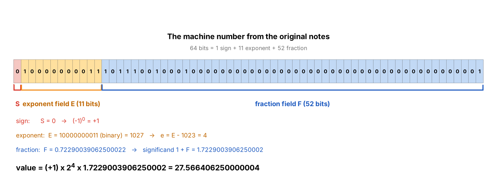
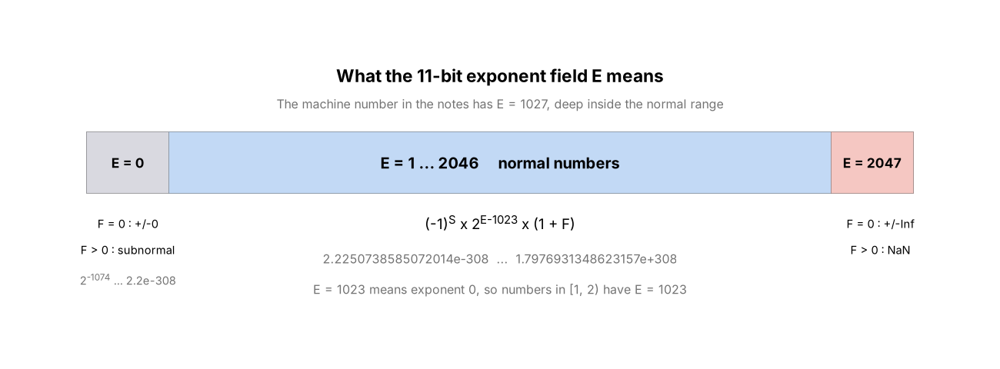
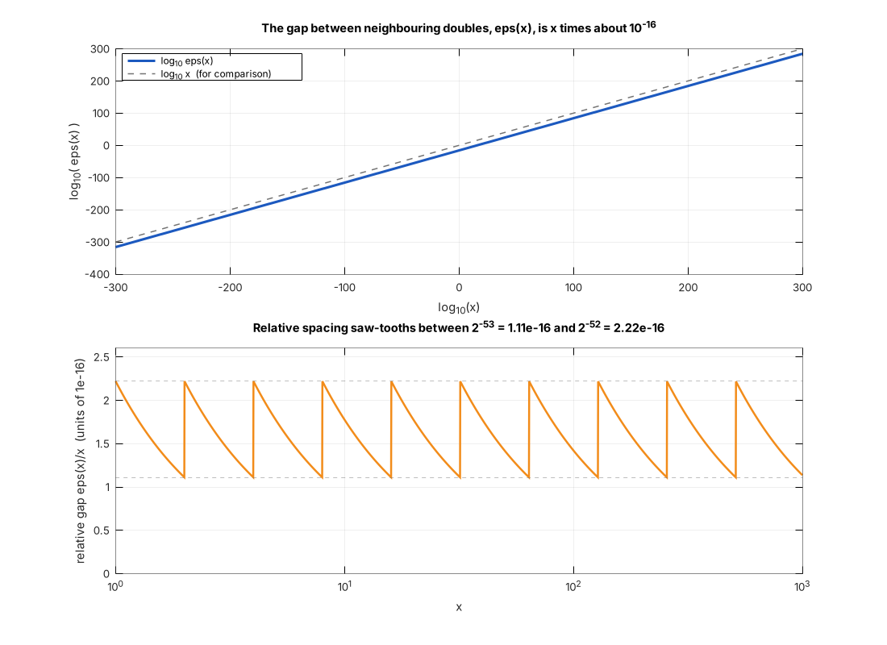
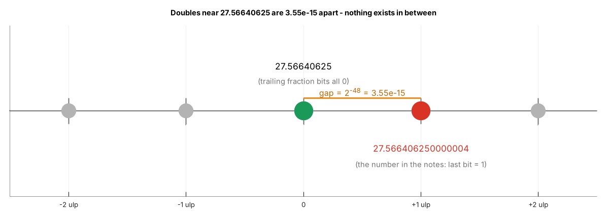
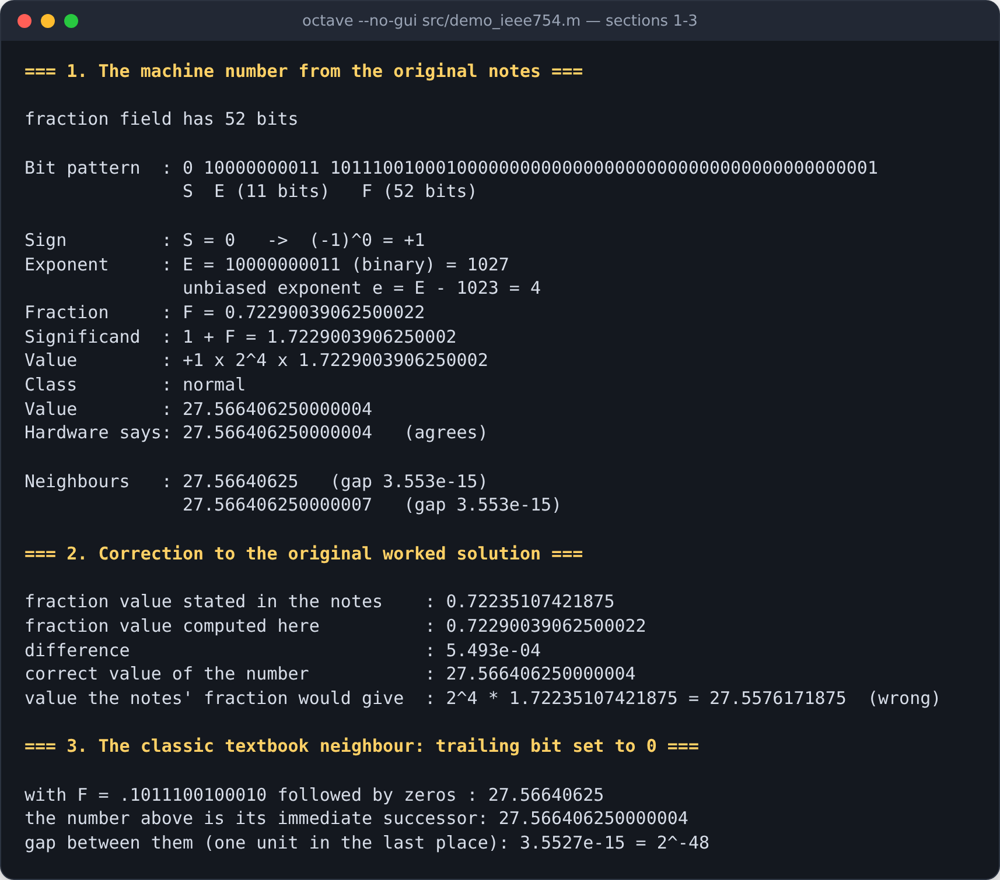
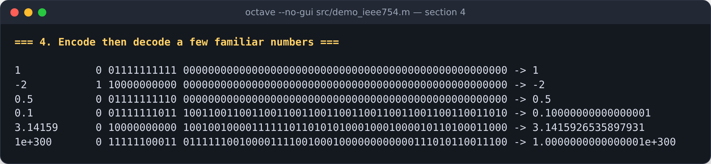
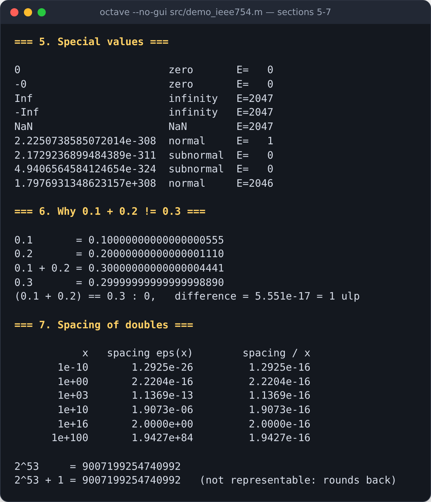
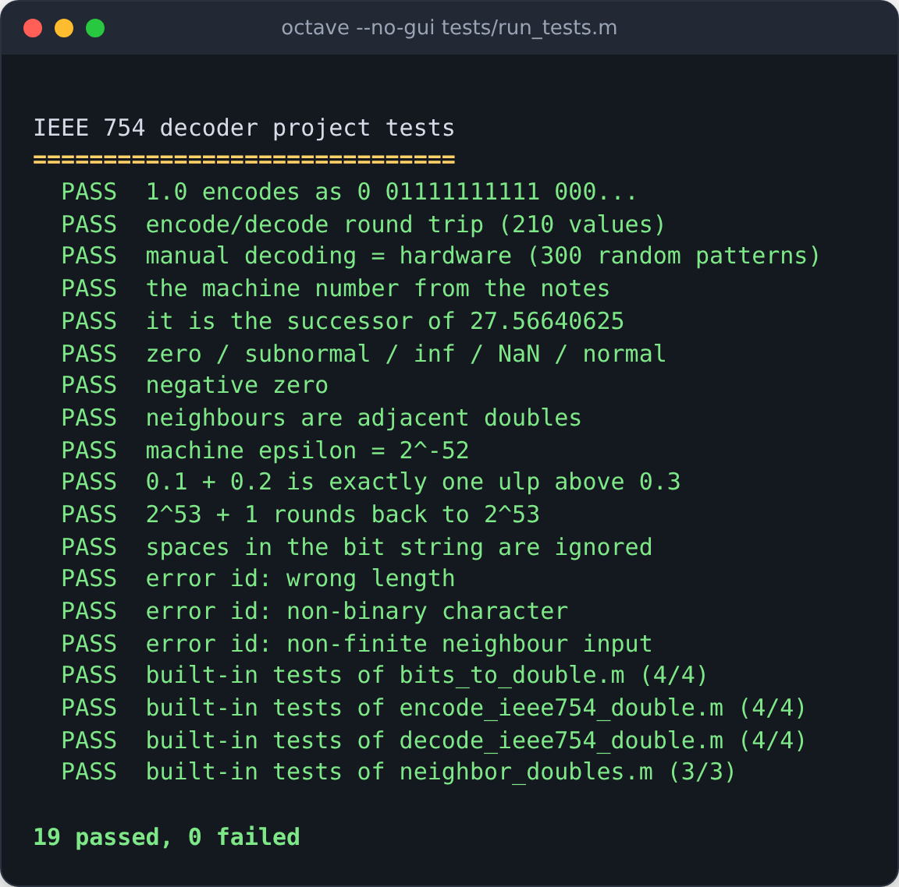
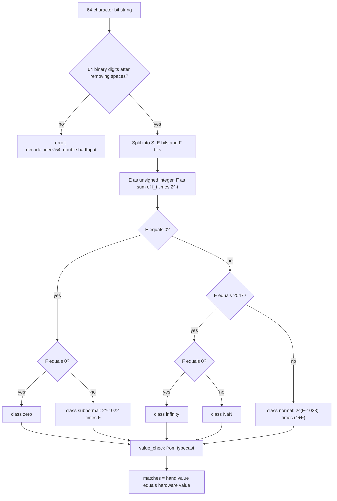
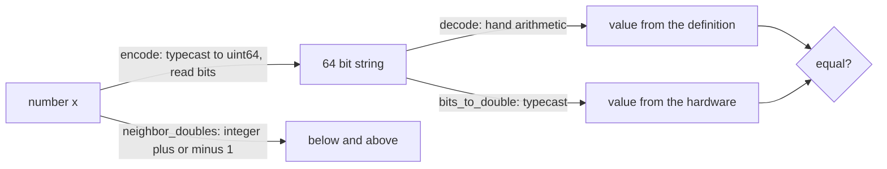

# IEEE 754 Double-Precision Floating-Point Machine Number Decoder (GNU Octave)

[](https://octave.org/)
[](LICENSE)
[](https://github.com/YOUR-USERNAME/ieee-754-double-precision-floating-point-machine-number-decoder-gnu-octave/actions/workflows/octave-tests.yml)


A small, well-tested, heavily documented toolkit that **decodes a 64-bit IEEE 754 binary64 ("double precision") machine number by hand** in **GNU Octave** — sign, exponent, fraction, significand, value — and then checks its own arithmetic against what the hardware thinks the bits mean. It also encodes any number back into its 64 bits, finds the doubles immediately next to a number, prints a step-by-step report, and ships a demo that explains classic surprises such as `0.1 + 0.2 != 0.3` and `2^53 + 1 == 2^53`. Every plot and every number quoted in this README comes from a real run of the code in this repository.

> **Before you start:** the repository's `LICENSE` file contains the placeholder `[YOUR NAME]` as the copyright holder. Replace it with your own name before publishing.

---

## Table of contents

1. [Overview](#1-overview)
2. [Features](#2-features)
3. [Screenshot gallery](#3-screenshot-gallery)
4. [Theory](#4-theory)
5. [Algorithm](#5-algorithm)
6. [Project structure](#6-project-structure)
7. [Requirements and installation](#7-requirements-and-installation)
8. [Quick start](#8-quick-start)
9. [API reference](#9-api-reference)
10. [Worked examples with real output](#10-worked-examples-with-real-output)
11. [Code walkthrough](#11-code-walkthrough)
12. [Error analysis](#12-error-analysis)
13. [Edge cases and limitations](#13-edge-cases-and-limitations)
14. [Running the tests](#14-running-the-tests)
15. [Regenerating the images and sample output](#15-regenerating-the-images-and-sample-output)
16. [Exercises](#16-exercises)
17. [Extension ideas](#17-extension-ideas)
18. [Original notes and what changed](#18-original-notes-and-what-changed)
19. [FAQ](#19-faq)
20. [Glossary](#20-glossary)
21. [References](#21-references)
22. [Contributing](#22-contributing)
23. [License](#23-license)

---

## 1. Overview

Every `double` in Octave, MATLAB, Python, C, Java and JavaScript is stored in exactly 64 bits following the **IEEE 754 binary64** format:

```
 S  EEEEEEEEEEE  FFFFFFFFFFFFFFFFFFFFFFFFFFFFFFFFFFFFFFFFFFFFFFFFFFFF
 1     11 bits                       52 bits
```

A typical numerical-analysis exercise hands you such a bit pattern and asks: *what number is this?* The answer is a short recipe — read the sign, read the exponent field and subtract the bias 1023, read the fraction field as a binary fraction, and combine them as

$$x = (-1)^S \times 2^{E - 1023} \times (1 + F).$$

This project turns that recipe into code you can trust, and then goes further:

* it **decodes** a bit string using only the definition (no hidden hardware shortcut), shows each intermediate quantity, and **cross-checks** the result against the machine's own interpretation of the same 64 bits (`typecast`);
* it **encodes** any real number into its 64 bits so you can see what the computer actually stores;
* it finds the **neighbouring doubles** (one bit up, one bit down) so you can see that the number line of doubles is a discrete set with gaps;
* it recognises all five **classes**: normal, subnormal, zero, infinity and NaN.

**The worked problem used throughout** is the machine number from the original course notes:

```
0 10000000011 1011100100010000000000000000000000000000000000000001
S E (11 bits) F (52 bits)
```

It decodes to

$$x = (+1)\times 2^{4}\times 1.7229003906250002 = 27.566406250000004,$$

which is the double **immediately above** the "nice" decimal number $27.56640625$ (the two differ by one unit in the last place, $2^{-48} \approx 3.55\times10^{-15}$). The original notes quoted a different, incorrect fraction value; see [section 18](#18-original-notes-and-what-changed).

## 2. Features

- **`decode_ieee754_double(bits)`** rebuilds the value from the definition and returns a struct: sign bit, exponent bits, fraction bits, sign, exponent field $E$, unbiased exponent $e$, fraction $F$, significand, class, value, the hardware value (`value_check`) and a `matches` flag.
- **`encode_ieee754_double(x)`** returns the 64-character bit string of a real number (and, optionally, a struct with the three fields separately).
- **`bits_to_double(bits)`** reinterprets 64 bits as a double using `typecast` on a `uint64` — the machine's own opinion, independent of the hand arithmetic.
- **`neighbor_doubles(x)`** returns the doubles just below and just above `x` and the gaps to them, by adding or subtracting 1 in the 64-bit integer representation.
- **`ieee754_report(x_or_bits)`** prints a readable step-by-step decoding of a number or of a bit string, followed by its two neighbours.
- **All five classes handled:** `normal`, `subnormal`, `zero` (including negative zero), `infinity` and `NaN`.
- **Spaces allowed** in bit strings, so you can paste `0 10000000011 1011...` exactly as it appears in a textbook.
- **Defensive validation** with stable error identifiers (`decode_ieee754_double:badInput`, `bits_to_double:badInput`, `encode_ieee754_double:badInput`, `neighbor_doubles:badInput`).
- **Seven-section demo** (`demo_ieee754`): the original number, the correction to the notes, the textbook neighbour, encode/decode of familiar numbers, special values, why `0.1 + 0.2 != 0.3`, and the spacing of doubles.
- **19 automated checks**, including 300 random bit patterns decoded by hand and compared with the hardware, plus a GitHub Actions workflow and reproducible plot / sample-output scripts.

## 3. Screenshot gallery

### Plots



*The worked example. The 64 bits are split into the sign (red), the 11-bit exponent field (orange) and the 52-bit fraction field (blue). Underneath: $S = 0$, $E = 10000000011_2 = 1027$ so $e = 4$, $F = 0.72290039062500022$ so the significand is $1.7229003906250002$, and the value $27.566406250000004$.*



*The three regions of the exponent field. $E = 0$ gives $\pm 0$ (fraction 0) or subnormal numbers (fraction $> 0$); $E = 1\ldots2046$ gives normal numbers $(-1)^S 2^{E-1023}(1+F)$ from $2.2250738585072014\times10^{-308}$ to $1.7976931348623157\times10^{308}$; $E = 2047$ gives $\pm\infty$ or NaN. Numbers in $[1,2)$ have $E = 1023$.*



*Top: $\log_{10}$ of the gap $\text{eps}(x)$ against $\log_{10} x$ from $10^{-300}$ to $10^{300}$ — a straight line just below $y = x$, because the gap is $x$ times about $10^{-16}$. Bottom: the relative gap $\text{eps}(x)/x$ on $[1, 1000]$ is a saw-tooth that resets at every power of two and stays between $2^{-53} = 1.11\times10^{-16}$ and $2^{-52} = 2.22\times10^{-16}$.*



*The doubles near $27.56640625$, measured in units in the last place (ulp). The green dot is $27.56640625$ (all trailing fraction bits zero); the red dot is the number from the notes, $27.566406250000004$ (last bit one), exactly $2^{-48} = 3.55\times10^{-15}$ above it. Nothing exists in between.*

### Terminal screenshots



*Demo sections 1–3: the step-by-step report for the original number, the correction to the notes' fraction value, and the textbook neighbour with trailing bit zero.*



*Demo section 4: six familiar numbers encoded into bits and decoded again.*



*Demo sections 5–7: the classes of special values, the decimal expansion of `0.1`, `0.2`, `0.1 + 0.2` and `0.3`, and the spacing table.*



*The test-suite: 19 passed, 0 failed.*

## 4. Theory

### 4.1 The 64-bit layout

A binary64 number has three fields, most significant bit first:

| Field | Bits | Positions | Meaning |
|---|---|---|---|
| Sign $S$ | 1 | bit 1 | $0$ = positive, $1$ = negative |
| Exponent $E$ | 11 | bits 2–12 | unsigned integer $0 \le E \le 2047$ |
| Fraction $F$ | 52 | bits 13–64 | binary fraction $F = \sum_{i=1}^{52} f_i\,2^{-i}$ |

So $F$ is a number in $[0, 1)$ whose binary expansion is the 52 fraction bits after the radix point, and $E$ is an ordinary unsigned integer written in binary.

### 4.2 The five classes

$$
x =
\begin{cases}
(-1)^S \cdot 2^{E-1023}\cdot(1+F) & 0 < E < 2047 \quad\text{(normal)}\\[2pt]
(-1)^S \cdot 2^{-1022}\cdot F & E = 0,\ F > 0 \quad\text{(subnormal)}\\[2pt]
(-1)^S \cdot 0 & E = 0,\ F = 0 \quad\text{(zero, $+0$ or $-0$)}\\[2pt]
(-1)^S \cdot \infty & E = 2047,\ F = 0\\[2pt]
\text{NaN} & E = 2047,\ F > 0
\end{cases}
$$

* The **bias** 1023 lets the 11-bit unsigned field represent exponents from $-1022$ to $+1023$ without a separate sign bit. The unbiased exponent is $e = E - 1023$.
* The leading 1 in $(1+F)$ is **implicit** (the "hidden bit"). That is why 52 stored bits give 53 bits of precision.
* **Subnormal** numbers drop the hidden bit and fix the exponent at $-1022$, which fills the gap between zero and the smallest normal number.
* The exponent field $E = 2047$ is reserved for $\pm\infty$ and NaN.

### 4.3 Important constants

| Quantity | Formula | Value |
|---|---|---|
| Smallest positive normal (`realmin`) | $2^{-1022}$ | $2.2250738585072014\times10^{-308}$ |
| Largest finite (`realmax`) | $(2 - 2^{-52})\,2^{1023}$ | $1.7976931348623157\times10^{308}$ |
| Smallest positive subnormal | $2^{-1074}$ | $4.9406564584124654\times10^{-324}$ |
| Machine epsilon (`eps`) | $2^{-52}$ | $2.2204\times10^{-16}$ |
| Largest integer such that all smaller ones are exact | $2^{53}$ | $9007199254740992$ |

(The three decimal values in the first, second and third rows are printed by demo section 5; the `eps` value by demo section 7.)

### 4.4 Worked example by hand

Take the bit pattern from the notes.

**Sign.** $S = 0$, so $(-1)^S = +1$.

**Exponent.** $E = 10000000011_2 = 2^{10} + 2^1 + 2^0 = 1024 + 2 + 1 = 1027$. The unbiased exponent is $e = 1027 - 1023 = 4$.

**Fraction.** The 52 fraction bits are `1011100100010000000000000000000000000000000000000001`. The bits equal to 1 are in positions 1, 3, 4, 5, 8, 12 and 52, so

$$F = 2^{-1} + 2^{-3} + 2^{-4} + 2^{-5} + 2^{-8} + 2^{-12} + 2^{-52}.$$

The first six terms add up to $0.722900390625$ (this is the value you get if you stop at the first 13 fraction bits), and the last bit contributes $2^{-52} \approx 2.2\times10^{-16}$:

$$F = 0.722900390625 + 2^{-52} = 0.72290039062500022\ (\text{17 significant digits}).$$

**Combine.**

$$x = (+1)\cdot 2^{4}\cdot(1 + 0.722900390625 + 2^{-52}) = 27.56640625 + 2^{4}\cdot 2^{-52} = 27.56640625 + 2^{-48}.$$

In 17 significant digits that is $27.566406250000004$. The "$+2^{-48}$" is the whole story of the last fraction bit: it has weight $2^{-52}$ in the significand and the exponent scales it by $2^{4}$.

### 4.5 Spacing of doubles, ulp and machine epsilon

For a normal number with unbiased exponent $e$ the last fraction bit has weight $2^{e-52}$. This is one **unit in the last place** (ulp):

$$\operatorname{ulp}(x) = 2^{\,e-52}, \qquad 2^{e} \le |x| < 2^{e+1}.$$

Consequences:

* Doubles are **not evenly spaced**. The gap doubles every time you cross a power of two.
* The *relative* gap stays within a factor of two: $\operatorname{ulp}(x)/|x| \in (2^{-53}, 2^{-52}]$. This is the saw-tooth in the spacing plot.
* For $x \in [1, 2)$ the gap is $2^{-52} = \text{eps}$. For the number in the notes, $e = 4$, so the gap is $2^{4-52} = 2^{-48} = 3.55\times10^{-15}$.
* Below a power of two the spacing is half as large as above it (the neighbours of 1 are $1 - 2^{-53}$ and $1 + 2^{-52}$).

### 4.6 Rounding a real number into a double

When a real number is not representable it is rounded (by default, to nearest, ties to even) to one of the two adjacent doubles. The resulting **relative** error is at most the unit roundoff

$$u = 2^{-53} \approx 1.11\times10^{-16}.$$

That is why a double carries about 15–16 reliable significant decimal digits, and why 17 significant digits (`%.17g`) are enough to print any double so that it can be read back exactly.

### 4.7 Why `0.1 + 0.2 != 0.3`

None of $0.1$, $0.2$, $0.3$ has a finite binary expansion, so each is stored as the nearest double. The sum of the stored $0.1$ and $0.2$ is rounded to a double that is **one ulp above** the stored $0.3$; the difference is $5.551\times10^{-17}$, exactly `eps(0.3)`.

### 4.8 Integers and $2^{53}$

Every integer with $|n| \le 2^{53}$ is exactly representable. Above $2^{53}$ the gap between doubles is at least 2, so $2^{53} + 1$ is not representable and rounds back to $2^{53}$.

## 5. Algorithm

### 5.1 Decoding (what `decode_ieee754_double` does)

```text
function decode(bits):
    s <- remove all whitespace from bits
    if length(s) != 64 or s contains a character other than 0 and 1:
        raise decode_ieee754_double:badInput
    S <- s[1];   Ebits <- s[2..12];   Fbits <- s[13..64]
    E <- Ebits read as an unsigned binary integer          (Horner's rule)
    F <- sum over i = 1..52 of (Fbits[i] == '1') * 2^(-i)  (exact in binary64)

    if E == 0 and F == 0:      class <- zero;       value <- (-1)^S * 0
    else if E == 0:            class <- subnormal;  value <- (-1)^S * 2^(-1022) * F
    else if E == 2047 and F == 0: class <- infinity; value <- (-1)^S * Inf
    else if E == 2047:         class <- NaN;        value <- NaN
    else:                      class <- normal
                               e <- E - 1023
                               value <- (-1)^S * 2^e * (1 + F)

    value_check <- bits_to_double(s)             (typecast of the same 64 bits)
    matches <- (value == value_check, with equal signs of zero)  or both NaN
    return everything as a struct
```



### 5.2 Encoding

```text
function encode(x):
    check x is a real numeric scalar
    u <- typecast(double(x), uint64)           (same 64 bits, read as an integer)
    b <- bits of u from bit 64 down to bit 1    (most significant first)
    return the characters '0'/'1', split as 1 + 11 + 52
```

### 5.3 Neighbours

```text
function neighbors(x):
    check x is a finite real scalar
    if x == 0:  below <- -2^(-1074);  above <- +2^(-1074)
    else:
        u    <- typecast(x, uint64)
        up   <- typecast(u + 1, double)        (next larger magnitude)
        down <- typecast(u - 1, double)        (next smaller magnitude)
        if x > 0:  above <- up;   below <- down
        else:      above <- down; below <- up
    gap_below <- x - below;   gap_above <- above - x
```

Adjacent doubles of the same sign have adjacent integer representations, which is why adding or subtracting 1 gives the neighbours. For a negative number, a larger integer means a larger *magnitude*, so the roles of `up` and `down` swap.



## 6. Project structure

```
ieee-754-double-precision-floating-point-machine-number-decoder-gnu-octave/
├── README.md
├── LICENSE                          MIT (replace [YOUR NAME])
├── .gitignore
├── .gitattributes                   marks *.m as MATLAB/Octave for GitHub
├── .github/workflows/octave-tests.yml
├── src/
│   ├── decode_ieee754_double.m      hand decoding + hardware cross-check
│   ├── encode_ieee754_double.m      number -> 64 bits
│   ├── bits_to_double.m             64 bits -> number via typecast
│   ├── neighbor_doubles.m           doubles just below / above x
│   ├── ieee754_report.m             step-by-step printed report
│   └── demo_ieee754.m               seven-section demo
├── tests/
│   └── run_tests.m                  19 checks, exit status 1 on failure
├── scripts/
│   ├── generate_images.m            re-creates the four plots
│   ├── save_figure.m                helper that saves a PNG headlessly
│   └── capture_sample_output.sh     re-creates docs/sample-output/
├── images/                          8 PNG files used in this README
└── docs/
    ├── sample-output/
    │   ├── demo-ieee754.txt         output of the demo
    │   └── test-results.txt         output of the test-suite
    └── original-notes/
        └── floating-point-analysis.txt   the original chat-style notes
```

## 7. Requirements and installation

**Requirements:** GNU Octave. This project was developed and tested with **Octave 8.4.0**, running headless (`octave --no-gui --quiet`). It uses only core Octave functions (`typecast`, `bitget`, `bitshift`, `bitor`, `uint64`, `eps`, `realmin`, `realmax`) — no extra packages. MATLAB has similar functions but was not tested, and the `%!test` blocks are an Octave feature.

| Platform | How to install Octave |
|---|---|
| Windows | Download the installer from the official download page at [octave.org](https://octave.org/download) and run it. |
| macOS | Use the official download page, or a package manager such as Homebrew (`brew install octave`). |
| Linux (Debian/Ubuntu) | `sudo apt-get update && sudo apt-get install octave` — this is exactly what the CI workflow does. |

Then get the code:

```bash
git clone https://github.com/YOUR-USERNAME/ieee-754-double-precision-floating-point-machine-number-decoder-gnu-octave.git
cd ieee-754-double-precision-floating-point-machine-number-decoder-gnu-octave
```

There is nothing to build. From inside Octave, put `src/` on the path:

```octave
addpath("src");
```

## 8. Quick start

Decode a bit string (spaces are optional):

```octave
addpath("src");
r = decode_ieee754_double("0 10000000011 1011100100010000000000000000000000000000000000000001");
printf("%.17g\n", r.value);       % 27.566406250000004
disp(r.class)                      % normal
disp(r.exponent)                   % 4
disp(r.matches)                    % 1  (hand arithmetic agrees with the hardware)
```

Print the full step-by-step report for a number or a bit string:

```octave
ieee754_report(0.1);
```

(End the call with a semicolon: the function also returns the decoded struct, which Octave would otherwise print as `ans`.)

Run the demo or the tests from the project root:

```bash
octave --no-gui --quiet src/demo_ieee754.m
octave --no-gui --quiet tests/run_tests.m
```

## 9. API reference

### 9.1 `decode_ieee754_double`

```octave
r = decode_ieee754_double(bits)
```

| | |
|---|---|
| **Input** | `bits` — string of 64 binary digits; whitespace is ignored. |
| **Output** | struct `r` with the fields listed below. |
| **Error** | `decode_ieee754_double:badInput` if the string (without spaces) is not exactly 64 characters of `0`/`1`. |

| Field | Meaning |
|---|---|
| `sign_bit`, `exponent_bits`, `fraction_bits` | the three fields as strings (1, 11 and 52 characters) |
| `sign` | $(-1)^S$, i.e. `+1` or `-1` |
| `exponent_field` | $E$ as an integer (0–2047) |
| `exponent` | unbiased exponent $e$: $E - 1023$ for normal numbers, $-1022$ for zero and subnormals, $1024$ for infinity and NaN |
| `fraction` | $F$ as a double |
| `significand` | $1 + F$ (normal), $F$ (subnormal), `0` (zero), `NaN` (infinity and NaN) |
| `class` | `"normal"`, `"subnormal"`, `"zero"`, `"infinity"` or `"NaN"` |
| `value` | the value rebuilt by hand from the definition |
| `value_check` | the value the hardware assigns to the same 64 bits |
| `matches` | `true` if `value` and `value_check` agree (equal signs for zero; both NaN counts as agreement) |

### 9.2 `encode_ieee754_double`

```octave
bits = encode_ieee754_double(x)
[bits, fields] = encode_ieee754_double(x)
```

| | |
|---|---|
| **Input** | `x` — real numeric scalar. |
| **Output** | `bits` — 64-character string; `fields` — struct with strings `sign`, `exponent`, `fraction`. |
| **Error** | `encode_ieee754_double:badInput` if `x` is not a real numeric scalar (for example a vector). |

```octave
>> encode_ieee754_double(1)
ans = 0011111111110000000000000000000000000000000000000000000000000000
>> encode_ieee754_double(-2)
ans = 1100000000000000000000000000000000000000000000000000000000000000
```

A `single` input is converted to `double` first, so the result is the 64-bit pattern of the same *value*, not the 32-bit pattern.

### 9.3 `bits_to_double`

```octave
x = bits_to_double(bits)
```

| | |
|---|---|
| **Input** | `bits` — 64 binary digits, whitespace ignored. |
| **Output** | the double the hardware assigns to those bits. |
| **Error** | `bits_to_double:badInput` for a wrong length or non-binary characters. |

Implementation: pack the bits into a `uint64` with `bitshift`/`bitor`, then `typecast(u, "double")`.

### 9.4 `neighbor_doubles`

```octave
[below, above, gap_below, gap_above] = neighbor_doubles(x)
```

| | |
|---|---|
| **Input** | `x` — finite real scalar. |
| **Output** | the next double below `x`, the next above `x`, and the two gaps `x - below` and `above - x`. For `x == 0` the neighbours are $\mp 2^{-1074}$. |
| **Error** | `neighbor_doubles:badInput` for non-scalar, non-real or non-finite input. |

```octave
>> [lo, hi, glo, ghi] = neighbor_doubles(1);
>> printf("%.17g %.17g %.4e %.4e\n", lo, hi, glo, ghi);
0.99999999999999989 1.0000000000000002 1.1102e-16 2.2204e-16
```

### 9.5 `ieee754_report`

```octave
ieee754_report(input);
r = ieee754_report(input);
```

`input` is either a number (it is encoded first) or a string of 64 bits. The function prints the bit pattern with a field legend, the sign, the exponent (with the bias subtracted for normal numbers), the fraction, the significand, the class, the value, the hardware value with `agrees`/`DISAGREES`, and — for finite values — the two neighbours with their gaps. It returns the struct from `decode_ieee754_double`.

### 9.6 `demo_ieee754`

A script (not a function) that prints the seven demo sections. Run it with `octave --no-gui --quiet src/demo_ieee754.m`.

## 10. Worked examples with real output

All blocks below are copied verbatim from `docs/sample-output/demo-ieee754.txt` (a real Octave 8.4 run), except where marked otherwise.

### 10.1 The machine number from the original notes

```text
=== 1. The machine number from the original notes ===

fraction field has 52 bits

Bit pattern  : 0 10000000011 1011100100010000000000000000000000000000000000000001
               S  E (11 bits)   F (52 bits)

Sign         : S = 0   ->  (-1)^0 = +1
Exponent     : E = 10000000011 (binary) = 1027
               unbiased exponent e = E - 1023 = 4
Fraction     : F = 0.72290039062500022
Significand  : 1 + F = 1.7229003906250002
Value        : +1 x 2^4 x 1.7229003906250002
Class        : normal
Value        : 27.566406250000004
Hardware says: 27.566406250000004   (agrees)

Neighbours   : 27.56640625   (gap 3.553e-15)
               27.566406250000007   (gap 3.553e-15)
```

Reading the report: the hand-built value and the `typecast` value agree. The lower neighbour is exactly `27.56640625` and the gap on both sides is $3.553\times10^{-15} = 2^{-48}$.

### 10.2 Correcting the original worked solution

```text
=== 2. Correction to the original worked solution ===

fraction value stated in the notes    : 0.72235107421875
fraction value computed here          : 0.72290039062500022
difference                            : 5.493e-04
correct value of the number           : 27.566406250000004
value the notes' fraction would give  : 2^4 * 1.72235107421875 = 27.5576171875  (wrong)
```

### 10.3 The classic textbook neighbour

If the last fraction bit is changed from 1 to 0, the number becomes the "nice" decimal $27.56640625$; the number in the notes is its immediate successor.

```text
=== 3. The classic textbook neighbour: trailing bit set to 0 ===

with F = .1011100100010 followed by zeros : 27.56640625
the number above is its immediate successor: 27.566406250000004
gap between them (one unit in the last place): 3.5527e-15 = 2^-48
```

### 10.4 Encode, then decode, familiar numbers

```text
=== 4. Encode then decode a few familiar numbers ===

1            0 01111111111 0000000000000000000000000000000000000000000000000000 -> 1
-2           1 10000000000 0000000000000000000000000000000000000000000000000000 -> -2
0.5          0 01111111110 0000000000000000000000000000000000000000000000000000 -> 0.5
0.1          0 01111111011 1001100110011001100110011001100110011001100110011010 -> 0.10000000000000001
3.14159      0 10000000000 1001001000011111101101010100010001000010110100011000 -> 3.1415926535897931
1e+300       0 11111100011 0111111001000011110010001000000000000111010110011100 -> 1.0000000000000001e+300
```

Notes:

* `1` has $E = 01111111111_2 = 1023$ (exponent 0) and $F = 0$; `-2` has $S = 1$, $E = 10000000000_2 = 1024$ (exponent 1) and $F = 0$; `0.5` has $E = 1022$ (exponent $-1$).
* The fraction of `0.1` is the repeating pattern `1001 1001 1001 ...` ending in `1010`, which is the rounded-up end of the infinite expansion.
* The row labelled `3.14159` is **not** $\pi$: its decoded value `3.1415926535897931` is the demo's `pi` (the demo prints `%-12g`, which shows `pi` as `3.14159`). The decoded value is the double closest to $\pi$.
* `1e+300` is not exactly $10^{300}$; the stored double is `1.0000000000000001e+300` when printed with 17 digits.

### 10.5 Special values

```text
=== 5. Special values ===

0                        zero       E=   0
-0                       zero       E=   0
Inf                      infinity   E=2047
-Inf                     infinity   E=2047
NaN                      NaN        E=2047
2.2250738585072014e-308  normal     E=   1
2.1729236899484389e-311  subnormal  E=   0
4.9406564584124654e-324  subnormal  E=   0
1.7976931348623157e+308  normal     E=2046
```

The smallest normal number `realmin` has $E = 1$; dividing it by $2^{10}$ gives a subnormal; $2^{-1074}$ is the smallest positive subnormal (only the last fraction bit is set); `realmax` has $E = 2046$.

### 10.6 Why `0.1 + 0.2 != 0.3`

```text
=== 6. Why 0.1 + 0.2 != 0.3 ===

0.1       = 0.10000000000000000555
0.2       = 0.20000000000000001110
0.1 + 0.2 = 0.30000000000000004441
0.3       = 0.29999999999999998890
(0.1 + 0.2) == 0.3 : 0,   difference = 5.551e-17 = 1 ulp
```

Both `0.1` and `0.2` are stored slightly too large; `0.3` is stored slightly too small; their sum rounds to the next double above the stored `0.3`.

### 10.7 Spacing of doubles

```text
=== 7. Spacing of doubles ===

           x   spacing eps(x)        spacing / x
       1e-10       1.2925e-26         1.2925e-16
       1e+00       2.2204e-16         2.2204e-16
       1e+03       1.1369e-13         1.1369e-16
       1e+10       1.9073e-06         1.9073e-16
       1e+16       2.0000e+00         2.0000e-16
      1e+100       1.9427e+84         1.9427e-16

2^53     = 9007199254740992
2^53 + 1 = 9007199254740992   (not representable: rounds back)
```

The absolute spacing spans 110 orders of magnitude in this table, while the relative spacing stays near $10^{-16}$. At $10^{16}$ the spacing is already 2, so not every integer is representable.

### 10.8 A different number: `ieee754_report(0.1)`

This block was produced by running `ieee754_report(0.1);` in Octave 8.4 (it is not part of the saved demo output):

```text
Bit pattern  : 0 01111111011 1001100110011001100110011001100110011001100110011010
               S  E (11 bits)   F (52 bits)

Sign         : S = 0   ->  (-1)^0 = +1
Exponent     : E = 01111111011 (binary) = 1019
               unbiased exponent e = E - 1023 = -4
Fraction     : F = 0.60000000000000009
Significand  : 1 + F = 1.6000000000000001
Value        : +1 x 2^-4 x 1.6000000000000001
Class        : normal
Value        : 0.10000000000000001
Hardware says: 0.10000000000000001   (agrees)

Neighbours   : 0.099999999999999992   (gap 1.388e-17)
               0.10000000000000002   (gap 1.388e-17)
```

So $0.1 = 2^{-4} \times 1.6000000000000001$: the "$0.6$" in the fraction is itself not exact in binary.

### 10.9 Tests

```text
IEEE 754 decoder project tests
==============================
  PASS  1.0 encodes as 0 01111111111 000...
  PASS  encode/decode round trip (210 values)
  PASS  manual decoding = hardware (300 random patterns)
  PASS  the machine number from the notes
  PASS  it is the successor of 27.56640625
  PASS  zero / subnormal / inf / NaN / normal
  PASS  negative zero
  PASS  neighbours are adjacent doubles
  PASS  machine epsilon = 2^-52
  PASS  0.1 + 0.2 is exactly one ulp above 0.3
  PASS  2^53 + 1 rounds back to 2^53
  PASS  spaces in the bit string are ignored
  PASS  error id: wrong length
  PASS  error id: non-binary character
  PASS  error id: non-finite neighbour input
  PASS  built-in tests of bits_to_double.m (4/4)
  PASS  built-in tests of encode_ieee754_double.m (4/4)
  PASS  built-in tests of decode_ieee754_double.m (4/4)
  PASS  built-in tests of neighbor_doubles.m (3/3)

19 passed, 0 failed
```

## 11. Code walkthrough

### 11.1 `bits_to_double.m` — the machine's opinion

The function strips whitespace, checks that exactly 64 characters of `0`/`1` remain, and builds a `uint64` one bit at a time:

```octave
u = uint64(0);
for i = 1:64
  u = bitor(bitshift(u, 1), uint64(s(i) == "1"));
end
x = typecast(u, "double");
```

`typecast` reinterprets the same eight bytes as a `double` without any arithmetic, so this is an independent oracle for the hand decoder.

### 11.2 `decode_ieee754_double.m` — the definition, line by line

1. **Validation:** remove spaces and check for 64 binary digits.
2. **Slicing:** `s(1)`, `s(2:12)`, `s(13:64)` are the three fields.
3. **Exponent:** Horner's rule, `E = E * 2 + double(bit)`, over the 11 exponent bits.
4. **Fraction:** `F = sum((fraction_bits == "1") .* 2 .^ (-(1:52)))`. Every partial sum is a multiple of $2^{-52}$ below 2, so the sum is exact in binary64.
5. **Classification:** an `if/elseif` chain on `E` and `F` selects zero, subnormal, infinity, NaN or normal, and computes the value with the matching formula.
6. **Cross-check:** `value_check = bits_to_double(s)`; `matches` is true if the values are equal *and* have the same sign when inverted (`sign(1 / value)`), which distinguishes $+0$ from $-0$; two NaNs also count as matching.

### 11.3 `encode_ieee754_double.m`

`typecast(double(x), "uint64")` gives the integer with the same bits; `bitget(u, 64:-1:1)` extracts them most significant first; adding the character code of `"0"` turns them into text. The result is cut into the sign (1), exponent (2–12) and fraction (13–64) strings.

### 11.4 `neighbor_doubles.m`

Adjacent doubles of the same sign have consecutive integer representations. The function adds and subtracts 1 in `uint64` and `typecast`s back; the sign of `x` decides which result is "above" and which is "below". Zero is special-cased because its neighbours have opposite signs.

### 11.5 `ieee754_report.m`

A printing wrapper: if its input is text it is used as bits, otherwise it is encoded first; then `decode_ieee754_double` and `neighbor_doubles` supply the numbers to print.

### 11.6 `tests/run_tests.m`

A script starting with `1;` (so that functions can be defined in a script file). A small `run_case` helper counts passes and failures and prints `PASS`/`FAIL`. The suite ends with `exit(1)` on any failure so CI notices. The last four cases run each source file's built-in `%!test` blocks via `test(name, "quiet")`.

## 12. Error analysis

**The hand decoder is exact.** For a normal number every operation in `decode_ieee754_double` is exact in binary64:

* $E$ is an integer below 2048;
* $F$ is a sum of distinct powers of two between $2^{-1}$ and $2^{-52}$, so it is a multiple of $2^{-52}$ below 1 and fits in 53 bits;
* $1 + F$ is a multiple of $2^{-52}$ below 2, also exact;
* multiplying by $2^e$ only changes the exponent.

For subnormals, $2^{-1022}\cdot F$ is a multiple of $2^{-1074}$, again exact. That is why the test-suite can demand *equality* between the hand value and `typecast`, not just closeness; it holds for all 300 random bit patterns and for the 210-value round trip.

**Representation error of decimal numbers.** When a decimal such as 0.1 is stored, it is rounded to the nearest double; the relative error is at most $u = 2^{-53} \approx 1.11\times10^{-16}$. For $0.1$ the stored value is $0.10000000000000000555\ldots$, i.e. an absolute error of about $5.55\times10^{-18}$.

**Errors accumulate at the level of one ulp.** Demo section 6 shows that the sum $0.1 + 0.2$ lands exactly one ulp above the stored $0.3$: the difference is $5.551\times10^{-17}$. The ulp there is `eps(0.3)`.

**Printing.** `%.17g` prints enough digits to identify any double. Octave's default short display shows only about 5 significant digits, which is why the demo uses explicit formats. The two neighbours of `27.566406250000004` print as `27.56640625` and `27.566406250000007` with 17 significant digits; the three values are distinct doubles even though their decimal expansions look almost identical.

**Absolute versus relative spacing.** The absolute gap grows with the number (from $1.2925\times10^{-26}$ at $10^{-10}$ to $1.9427\times10^{84}$ at $10^{100}$), while the relative gap stays in $(2^{-53}, 2^{-52}]$ (about $1.11$ to $2.22\times10^{-16}$).

## 13. Edge cases and limitations

* **Input must be exactly 64 bits.** Anything else raises `…:badInput`. Hexadecimal input is not supported.
* **Negative zero.** `encode_ieee754_double(-0)` gives `1000…0`; `decode_ieee754_double` reports class `zero` with `1/value == -Inf`, and `matches` is true.
* **NaN.** Any pattern with $E = 2047$ and $F > 0$ is class `NaN`; its payload is not decoded. In the Octave 8.4 session used for this README `encode_ieee754_double(NaN)` gave `0111111111111000…0` and `encode_ieee754_double(-NaN)` gave `1111111111111000…0`, i.e. the sign bit of a NaN is observable, even though it has no numerical meaning.
* **Infinity at the top of the range.** `neighbor_doubles(realmax)` returns `Inf` as the upper neighbour and an infinite upper gap, because incrementing the integer representation of `realmax` yields the pattern of `Inf`. `neighbor_doubles(Inf)` itself is rejected (non-finite input).
* **Zero.** `neighbor_doubles(0)` returns $\mp 2^{-1074}$; `neighbor_doubles(-0)` is treated as zero (`-0 == 0`).
* **Smallest subnormal.** `neighbor_doubles(2^-1074)` returns `0` below and `9.8813129168249309e-324` above, with both gaps equal to $2^{-1074}$.
* **`single` and integer types.** `encode_ieee754_double` accepts any real numeric scalar but always converts to `double`; it never reports a 32-bit pattern. Decoding binary32 or binary16 is not implemented.
* **Rounding modes** other than round-to-nearest-even are not modelled; the code never rounds, it only reinterprets bits.
* **Not a replacement for `num2hex`/`typecast`.** The hand decoder exists to teach; the cross-check uses `typecast` anyway.
* **Tested only with Octave 8.4.0.** MATLAB was not tested.

## 14. Running the tests

From the project root:

```bash
octave --no-gui --quiet tests/run_tests.m
```

The expected last line is `19 passed, 0 failed`; the exit status is 0 on success and 1 on failure. The six `%!test`/`%!assert` groups inside the source files can also be run individually:

```octave
addpath("src");
test decode_ieee754_double
test neighbor_doubles
```

The GitHub Actions workflow `.github/workflows/octave-tests.yml` installs Octave on `ubuntu-latest` and runs the same command on every push and pull request.

## 15. Regenerating the images and sample output

```bash
# the four plots in images/
octave --no-gui scripts/generate_images.m

# docs/sample-output/demo-ieee754.txt and test-results.txt
bash scripts/capture_sample_output.sh
```

`scripts/generate_images.m` uses `scripts/save_figure.m`, which saves PNGs headlessly (it chooses the `-dpngcairo` driver when the gnuplot graphics toolkit is active, otherwise `-dpng`) at 150 dpi.

The four terminal screenshots (`terminal-*.png`) are rendered images of the text in `docs/sample-output/` and were not produced by the Octave scripts; the plain-text sample output files are the source of truth for their content.

## 16. Exercises

1. **By hand.** Decode `0 10000000000 1001001000011111101101010100010001000010110100011000` using the formula. Check your answer with `decode_ieee754_double` (demo section 4 shows its value, `3.1415926535897931`).
2. **Powers of two.** Using only the exponent field, explain why every number in $[1, 2)$ has $E = 1023$ and every number in $[2, 4)$ has $E = 1024$. Verify with `encode_ieee754_double`.
3. **Successor of 1.** What is the double immediately above 1? Check with `neighbor_doubles(1)`. Why is the gap *below* 1 only half as large?
4. **Smallest normal.** Write down the bit pattern of `realmin` (hint: $E = 1$, $F = 0$) and confirm with `bits_to_double`.
5. **Smallest subnormal.** Which single bit is set in the pattern of $2^{-1074}$? Confirm with `encode_ieee754_double(2^-1074)`.
6. **The notes' mistake.** Find the 13-bit prefix of the fraction whose value is $0.722900390625$. What bit pattern would give the notes' $0.72235107421875$ instead? (Hint: work out $0.72235107421875 \times 2^{14}$.)
7. **Integers.** Show that every integer up to $2^{53}$ is representable but $2^{53}+1$ is not. What is the next integer above $2^{53}$ that *is* representable?
8. **0.1 + 0.2.** Use `ieee754_report` on `0.1 + 0.2` and on `0.3` and compare the last few fraction bits.
9. **Spacing.** Predict `eps(1000)` from the exponent, then compare with the table in section 10.7 (the entry for $10^3$ is `1.1369e-13`).
10. **Round trip.** Pick 20 random numbers with `rand` and confirm that `decode_ieee754_double(encode_ieee754_double(x)).value == x`.

## 17. Extension ideas

* Add **binary32** (single precision) and **binary16** (half precision) decoders, parametrised by exponent and fraction width.
* Add a function returning the **distance between two doubles in ulps** by subtracting their integer representations.
* Print the pattern in **hexadecimal** and compare with Octave's `num2hex`.
* Implement **rounding of a decimal string** into a double by hand, with a choice of rounding mode.
* Decode the **NaN payload** and distinguish quiet from signalling NaNs.
* Build a small **interactive prompt** that asks for a bit string and prints the report.
* Show **fused multiply-add** and **compensated summation** (Kahan) examples that exploit the knowledge of one-ulp errors.
* Add a visualisation of the **subnormal range** near zero.

## 18. Original notes and what changed

`docs/original-notes/floating-point-analysis.txt` holds the original material for this project. It is a short, chat-style answer headed `## Bing`. It correctly identifies the layout (1 sign bit, 11 exponent bits, 52 fraction bits) and the formula $(-1)^s\, 2^{e-1023}\,(1+f)$, and it correctly converts the exponent field: $10000000011_2 = 1027$. It then states

```text
f = 1011100100010000000000000000000000000000000000000001 = 0.72235107421875 (in decimal)
```

and substitutes this into the formula, **without ever computing the final value**. It ends with a remark that "due to the precision limit of floating-point numbers, the calculated result might not be exact."

**What was wrong.**

* The decimal value of the fraction is not $0.72235107421875$. Computed from the bits it is $0.72290039062500022$ (the first 13 bits alone give $0.722900390625$, and the last bit adds $2^{-52}$). The two values differ by $5.493\times10^{-4}$ (demo section 2).
* Using the notes' fraction, $2^4 \times 1.72235107421875 = 27.5576171875$, which is **not** the number that the bits encode. The correct value is $27.566406250000004$.
* The final value was never given, so the "worked solution" was incomplete as well as numerically wrong.

**What changed in this project.**

* The decoder was implemented from the definition and **checked against the hardware** with `typecast`, including 300 random bit patterns.
* The corrected value $27.566406250000004$ is documented, and it is explained as the **immediate successor** of $27.56640625$ (gap $2^{-48}$), which is probably the number the textbook-style exercise was based on.
* Everything beyond the single worked example is **new in this repository**: encoding, neighbours, special values and subnormals, the `0.1 + 0.2` and $2^{53}$ demonstrations, the spacing plots, the tests and the CI workflow. The original notes contain only the decoding sketch quoted above.
* The original text file is kept unmodified in `docs/original-notes/` for reference.

## 19. FAQ

**Why is the exponent stored with a bias of 1023?**
A biased unsigned field lets exponents from $-1022$ to $+1023$ be stored without a separate sign, and makes the bit patterns of positive doubles sort in the same order as their values — which is also why adding 1 to the integer gives the next double.

**52 fraction bits, but "53 bits of precision"?**
For normal numbers the leading 1 of the significand is implicit, so only the 52 bits after it are stored.

**Why do I need 17 digits to print a double?**
Seventeen significant decimal digits are always enough to identify a binary64 number uniquely. Fewer digits can make two different doubles look the same.

**Why does the demo print `3.14159` for the row that decodes to `3.1415926535897931`?**
The left column uses `%-12g`, which shows only six significant digits; the right column uses `%.17g`.

**What is `matches` for?**
It compares the hand arithmetic with the hardware reading of the same bits, so a typo in the decoder would be caught immediately. It also treats $+0$ and $-0$ as different and two NaNs as equal.

**How can I decode a number given in hexadecimal?**
Convert each hex digit to four bits first. Octave's `dec2bin` or `num2hex` can help, but this project does not do it for you.

**Does this work for `single`?**
No. `encode_ieee754_double(single(1.5))` first converts to double. See [extension ideas](#17-extension-ideas).

**Why are there two Mermaid diagrams?**
The first shows the decoding decision tree; the second shows how encode, decode, `typecast` and `neighbor_doubles` fit together.

## 20. Glossary

| Term | Meaning |
|---|---|
| **binary64** | the IEEE 754 name for double precision: 1 + 11 + 52 bits |
| **bias** | the constant 1023 subtracted from the exponent field |
| **exponent field $E$** | the 11 bits after the sign, read as an unsigned integer |
| **unbiased exponent $e$** | $E - 1023$ for normal numbers |
| **fraction $F$** | the 52 low bits read as a binary fraction in $[0, 1)$ |
| **significand** | $1 + F$ for normal numbers ($F$ for subnormals) |
| **hidden bit** | the implicit leading 1 of a normal significand |
| **normal number** | $0 < E < 2047$ |
| **subnormal number** | $E = 0$, $F > 0$; no hidden bit, exponent $-1022$ |
| **ulp** | unit in the last place, the gap between adjacent doubles at $x$ |
| **machine epsilon** | $2^{-52}$, the gap between 1 and the next double |
| **unit roundoff** | $2^{-53}$, the largest relative rounding error for round-to-nearest |
| **NaN** | "not a number", $E = 2047$ with $F > 0$ |
| **typecast** | reinterpret bits as another type without changing them |
| **catastrophic cancellation** | loss of significant digits when subtracting nearly equal numbers |

## 21. References

1. *IEEE Standard for Floating-Point Arithmetic*, IEEE Std 754-2019.
2. D. Goldberg, "What Every Computer Scientist Should Know About Floating-Point Arithmetic", *ACM Computing Surveys* 23(1), 1991.
3. N. J. Higham, *Accuracy and Stability of Numerical Algorithms*, 2nd ed., SIAM, 2002.
4. M. L. Overton, *Numerical Computing with IEEE Floating Point Arithmetic*, SIAM, 2001.
5. GNU Octave documentation: `typecast`, `bitget`, `bitshift`, `eps`, `realmin`, `realmax`, `num2hex` — <https://docs.octave.org/>.

## 22. Contributing

Issues and pull requests are welcome. Before opening a pull request:

1. Run `octave --no-gui --quiet tests/run_tests.m` and make sure it ends with `0 failed`.
2. Add a `%!test` block or a case in `tests/run_tests.m` for any new behaviour.
3. If you change the demo or the plots, regenerate `docs/sample-output/` and `images/` (section 15) so the README stays in sync with the code.
4. Keep function documentation in the comment header (so `help function_name` works).

## 23. License

Released under the [MIT License](LICENSE). The `LICENSE` file currently names `[YOUR NAME]` as the copyright holder — replace it with your own name (and year, if you prefer) before you publish the repository.
